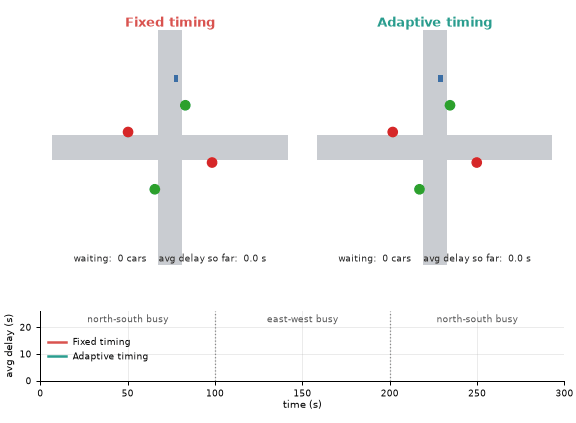
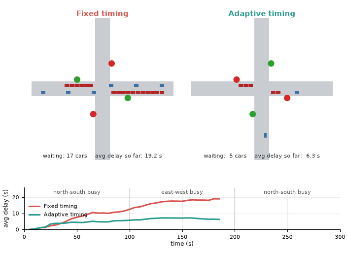
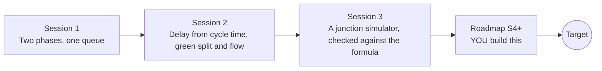

# opentrafficsignal

[](https://github.com/KrunalPanchal1995/opentrafficsignal/actions/workflows/ci.yml)   [](https://colab.research.google.com/github/KrunalPanchal1995/opentrafficsignal/blob/main/sessions/session-01/lesson.ipynb) [](https://krunalpanchal1995.github.io/opentrafficsignal/)

**Time a traffic-signal junction to cut waiting and queues, in three sessions.**

opentrafficsignal teaches how a signal turns a junction into queues and delays, from one green-amber-red cycle to a seeded simulation checked against Webster's formulas, using only Python and a browser.

- **Start from a queue.** Session 1 needs only arithmetic and a graph: cars arrive, cars leave on green, a queue builds.
- **See it move.** Every session ships a slider app that runs in the browser, with labelled graphs.
- **Know you got it right.** Each session ends with a checkpoint that prints PASS or FAIL against hand calculations and a formula.
- **Build the missing half.** The repo stops at Session 3 on purpose; the roadmap shows the path to the Target.

[Target](#the-target) · [Who is this for](#who-is-this-for) · [Quick start](#quick-start) · [Sessions](#sessions) · [Roadmap](#roadmap) · [Contribute](#contribute) · [Explainer PDF](docs/explainer.pdf)

> **This repo is incomplete on purpose.** Sessions 1 to 3 are here and fully working. The finished Target below is a preview of what the community can build next. We show you the path, not the code. Sessions 4 and up are yours.

## The Target

Two identical four-way junctions face the same rush hour: north-south busy, then east-west busy, then north-south again. On the left a fixed timetable, made for the average demand, lets queues pile up whenever the busy direction changes; its average delay climbs to about 22 seconds per car. On the right an adaptive controller watches the queues and moves the green to where the cars are; its average delay stays near 7 seconds. Live counters show cars waiting and the delay so far. Your goal over the coming sessions: build the adaptive half yourself, then give it time-varying demand, turning phases and a second junction.



*Target: fixed timing (left) versus adaptive timing (right) through a swinging rush hour*



*Target still: live counters and the running average delay of both junctions*


*Numerics course figure: a Burgers shock, the simplest model of the sharp front of a traffic jam*

Try it live:

- [Math Visual Studio: numerical PDEs, the next step towards traffic-flow models (Atlas S34)](https://krunalpanchal1995.github.io/studio/#atlas?ch=S34&ex=1)

How the Target was made is shown only as a path in [promo/roadmap.md](promo/roadmap.md).

## Who is this for
**middle school to higher secondary (levels 2-4).** Topic area: Everyday Life and Practical Knowledge.

Prerequisites:

- Arithmetic with fractions and decimals, and reading a line graph (Session 1). Squares and a simple formula with a fraction (Sessions 2 and 3).
- Python 3.10 or newer; if `python --version` works, you are ready. PRIMER.md explains the rest.
- No prior GitHub, calculus or traffic engineering experience is needed.

New to Python? Read [PRIMER.md](PRIMER.md) first (10 minutes).

## Quick start

No installation knowledge needed. You need [Git](https://git-scm.com/downloads) and [Python 3.10+](https://www.python.org/downloads/) (Windows: tick "Add Python to PATH"). On Mac and Linux type `python3` wherever this page says `python`.

```bash
git clone https://github.com/KrunalPanchal1995/opentrafficsignal.git
cd opentrafficsignal
python start.py 1
```

`start.py` creates a private environment, installs what is needed and runs Session 1 with its checkpoint. Next: `python start.py 2`, `python start.py 3`, or `python start.py test` to check everything. Only a checkpoint: `python start.py check 1`.

Four lines turn the idea of Session 2 into a result (they work as they are): Save it as `try.py` and run it with `python start.py run try.py` (this uses the private environment, where NumPy is installed):

```python
import numpy as np
q, s, C, g = 0.20, 0.50, 60.0, 27.0      # cars/s arriving, cars/s leaving on green, cycle s, green s
d = C * (1 - g / C) ** 2 / (2 * (1 - q / s))   # Webster uniform delay
print(np.round(d, 1), 's average wait per car')   # -> 15.1 s
```

Every session also opens in your browser with sliders (no install): [live apps](https://krunalpanchal1995.github.io/opentrafficsignal/). Or use the Colab badge above for the notebook.

## Sessions

| # | Session | Model level | Time | Live app |
|---|---|---|---|---|
| 1 | [Two phases, one queue](sessions/session-01/README.md) | Level 1: conceptual interactive model | 60 min | [open](https://krunalpanchal1995.github.io/opentrafficsignal/session-01/) |
| 2 | [Delay from cycle time, green split and flow](sessions/session-02/README.md) | Level 2: mathematical engineering model | 75 min | [open](https://krunalpanchal1995.github.io/opentrafficsignal/session-02/) |
| 3 | [A junction simulator, checked against the formula](sessions/session-03/README.md) | Level 3: simulation and validation | 90 min | [open](https://krunalpanchal1995.github.io/opentrafficsignal/session-03/) |

Each session follows the same six steps: A real-world problem, B concept and theory, C visual explanation, D interactive simulation, E worked example and experiment, F assessment and design challenge. Each ends with `checkpoint.py`, which prints `PASS` or `FAIL` against reference numbers. Session 3 also contains the real-world mini-project: **Time a junction from its traffic counts**.

## Architecture



| Folder or file | What is inside |
|---|---|
| `sessions/` | three sessions: README (A-F), `lesson.py`, notebook, live app, exercises, activity sheet, checkpoint |
| `promo/` | the Target: media, live links, and the roadmap (path only) |
| `docs/` | `explainer.tex` and the built `explainer.pdf` |
| `tests/` | runs every lesson and checkpoint headless |
| `start.py` | one command to set up and run anything |
| `QUALITY.md`, `RUBRIC.md` | the quality checklist and the scoring rubric |
| `.github/` | CI, PDF build, Pages deploy, issue and PR templates |

## Roadmap

| Milestone | What you will build | Difficulty |
|---|---|---|
| Session 4: The random delay term | A formula for the total average delay that combines the uniform term and a random term, validated against the simulator. | intermediate |
| Session 5: Adaptive timing for a swinging rush hour | A simulator with demand that changes every few minutes and a smarter adaptive rule (for example one that compares queue pressure of both phases). | advanced |
| Session 6: Three phases: a protected turn | A controller and simulator with three phases (the shipped one supports two). | advanced |
| Session 7: A green wave between two junctions | Two signals 400 m apart, cars travelling at 10 m/s, linked by an offset. | advanced |
| Session 8: Fit the model to real counts | A script that reads counts per minute from a CSV, estimates q and s and reports predicted delay and queue. | intermediate |

Full detail with a checkpoint per milestone: [promo/roadmap.md](promo/roadmap.md).

## Contribute
New to GitHub? Read [CONTRIBUTING.md](CONTRIBUTING.md); it starts from zero. Pick an issue labelled `good first issue`. Translations into Hindi, Telugu, Tamil and Malayalam are welcome.

<details>
<summary>Development</summary>

```bash
python start.py test        # runs every lesson and checkpoint
```
Lessons use `# %%` cell markers so they open as notebooks in VS Code. See [QUALITY.md](QUALITY.md) for the standard every session meets.
</details>

## License
MIT. See [LICENSE](LICENSE). Media in `promo/media` is (c) Krunal Panchal, CC BY 4.0.

## Acknowledgments
Part of the [PAN IIT OSS](https://hellofoss.tech-iitb.org/projects) open-source teaching collection, modelled on the structure of [openspline](https://github.com/openspline/openspline). Built on ideas from the Math Visual Studio at https://krunalpanchal1995.github.io/studio/.
