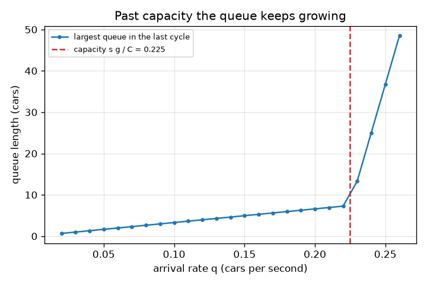
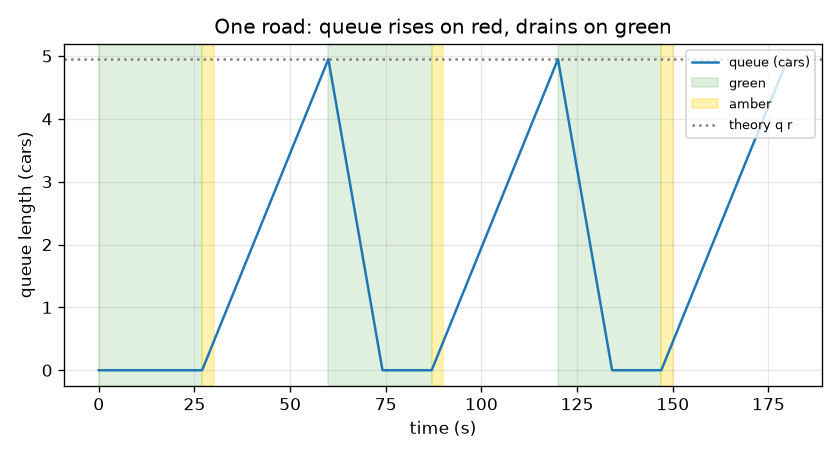

# Session 1: Two phases, one queue

*Level 1 (conceptual interactive model) · about 60 minutes · opentrafficsignal*

> This is a simplified educational model. It is not a validated design tool and must not be used for real structures, electrical installations, vehicles, industrial processes or medical decisions.

**Prerequisites**

- Arithmetic with decimals and reading a line graph.
- You have read PRIMER.md and run `python start.py 1` once.

**Learning objectives.** After this session you can:

- Describe a two-phase signal plan (green, amber, red) and its cycle time.
- Explain why a queue grows on red and shrinks on green.
- Predict the peak queue with q x r and the time to clear it with q r / (s - q).
- Read a graph of queue length against time and tell when a junction cannot cope.

## A. Real-world problem
At a four-way junction two roads cross, and only one may drive at a time. The signal alternates: green for road A while road B waits at red, then amber, then the other way round. Cars keep arriving on the waiting road, so a queue builds; when the light turns green the queue drains. Drivers feel this as waiting; a city feels it as queues that block the previous junction. How long does the queue get, and how long does it take to disappear? This is a simplified educational model, not a traffic engineering tool.

## B. Concept and theory
Each road gets a green time g, then an amber time a (3 s here; cars do not leave on amber, so it is lost time), then waits while the other road goes. For two equal phases the cycle time is C = 2 (g + a). Cars arrive at a steady rate q cars per second. On green they leave at the saturation flow s, the most cars per second that can leave a queue; about 0.5 cars per second per lane is a typical textbook value (about 1800 cars per hour), and real values vary with the road. A road is not green for r = C - g seconds. In that time q r cars arrive and none leave, so the queue peaks at q r. On green the queue shrinks at the speed s - q, so it needs q r / (s - q) seconds to vanish. If it does not vanish before the green ends, the leftover grows every cycle. The largest steady arrival rate a road can serve is its capacity s g / C.

| Symbol | Meaning | Unit |
|---|---|---|
| g | green time of one road | s |
| a | amber time (3 s here) | s |
| C | cycle time, 2 (g + a) | s |
| r | time a road is not green, C - g | s |
| q | arrival rate | cars per second |
| s | saturation flow (typical value 0.5 per lane) | cars per second |
| capacity | largest steady arrival rate, s g / C | cars per second |

**Assumptions**

- Two roads, equal green, symmetric plan; road B runs half a cycle behind road A.
- Arrivals are perfectly steady (no random bunches yet) and cars are treated as a smooth fluid.
- Cars leave at exactly s while a queue exists and green is on; nobody leaves on amber or red.
- One lane per road; no turning cars, pedestrians or buses.

$$ C = 2\,(g + a),\qquad r = C - g $$

$$ Q_{\max} = q\,r\quad\text{(cars waiting at the end of red)} $$

$$ t_{\text{clear}} = \frac{q\,r}{s - q}\quad\text{(seconds of green needed to empty the queue)} $$

$$ \text{capacity} = \frac{s\,g}{C},\qquad \text{the queue clears every cycle only if } q < \text{capacity} $$

## C. Visual explanation
The first figure plots the queue on one road for three cycles. It climbs in a straight line during red, peaks at 4.95 cars, then falls faster during green because cars leave at 0.5 cars per second while 0.15 arrive; the dotted line is the hand-calculation q r. The second figure repeats the experiment for many arrival rates with the same signal and plots the largest queue in the last cycle. It rises steadily until the arrival rate reaches the capacity 0.225 cars per second, then takes off: the queue no longer empties and grows cycle after cycle.

*Largest queue against arrival rate: it takes off at the capacity 0.225 cars per second.*

*One road for three cycles: the queue peaks at q r = 4.95 cars at the end of red.*

## D. Interactive simulation
Run the lesson (`python start.py 1`), then open the live app: [Session 1: one junction, two phases](https://krunalpanchal1995.github.io/opentrafficsignal/session-01/) (or `app.html` in this folder). Open the junction view and drag the time slider: watch the lights change and the boxes (cars) pile up on the waiting road. Then switch to the graph and change the green time and the arrival rate.

**Challenge.** Keep the first-cycle peak queue at 4 cars or fewer while the queue still clears every cycle (arrivals below the capacity).

## E. Worked example and experiment
**Problem.** A road has green g = 27 s, amber 3 s and cars arrive at q = 0.15 cars per second (s = 0.5). Find the cycle time, the red time, the peak queue, the time to clear it and the capacity. Does the queue clear every cycle?

1. C = 2 (27 + 3) = 60 s and r = C - g = 60 - 27 = 33 s.
2. Peak queue = q r = 0.15 x 33 = 4.95 cars.
3. Cars leave at 0.5 and arrive at 0.15, so the queue shrinks at 0.35 cars per second: t_clear = 4.95 / 0.35 = 14.14 s.
4. 14.14 s is less than the 27 s of green, so the queue clears with 12.9 s to spare.
5. Capacity = s g / C = 0.5 x 27 / 60 = 0.225 cars per second, above 0.15, which agrees.

**Answer.** C = 60 s, r = 33 s, peak queue 4.95 cars, cleared after 14.14 s of green; capacity 0.225 cars per second, so the queue clears every cycle. The simulation in lesson.py gives a peak of 4.93 cars.

**Experiment.** Stand at a junction with a stopwatch, count the cars that arrive during one red (do this for five cycles) and note when the queue has vanished after green. Compare the average count with q x r using your own estimate of q. Differences come from the model: real cars arrive in random bunches, drivers take time to start moving, and some amber time is used by cars; the model has none of these.

## F. Assessment and design challenge
**Question type A: Conceptual.** On green, cars leave at 0.5 cars per second, yet the queue shrinks more slowly than that. Why? What happens to the shrinking speed as the arrival rate gets closer to 0.5?

Hint

Cars keep arriving while the queue is draining.

Step-by-step solution

New cars join the back of the queue while old ones leave the front, so the queue shrinks at the difference s - q, not at s. As q approaches s the shrinking speed approaches zero and the clearing time q r / (s - q) grows without limit: a road that is almost always demanding the full saturation flow can never get rid of its queue.

**Question type B: Numerical.** Road A has green 20 s, amber 3 s and q = 0.10 cars per second (s = 0.5). Find C, r, the peak queue, the time to clear it and the capacity. Sanity check: is the answer in the right units?

Hint

C = 2 (g + a); peak = q r; clear time = peak / (s - q); capacity = s g / C.

Step-by-step solution

C = 2 (20 + 3) = 46 s and r = 46 - 20 = 26 s. Peak queue = 0.10 x 26 = 2.6 cars. Clear time = 2.6 / (0.5 - 0.1) = 6.5 s. Capacity = 0.5 x 20 / 46 = 0.217 cars per second. Units: cars per second times seconds gives cars; cars divided by cars per second gives seconds. 6.5 s is less than the 20 s green and 0.10 is below 0.217, so the queue clears every cycle.

**Question type C: Graph and simulation interpretation.** In the second figure (largest queue against arrival rate for g = 27 s), the points rise in a straight line and then take off. At what arrival rate does it happen, and what is happening to the queue after that?

Hint

Compare with the red dashed line, s g / C.

Step-by-step solution

The take-off is at the capacity s g / C = 0.225 cars per second. Below it the largest queue is q r = 33 q, a straight line through the origin with slope 33 s. Above it the arrivals per cycle exceed what one green can serve, so some cars are left over every cycle and the queue grows from one cycle to the next without limit.

**Question type D: Design and optimisation challenge.** Design: two equal roads each receive q = 0.18 cars per second. Choose the green time g (a whole number of seconds, amber 3 s) so that the queue clears every cycle and the peak queue is at most 6 cars. Which g would you pick and why?

Hint

Two conditions: capacity s g / C above 0.18, and q r at most 6 where r = g + 6.

Step-by-step solution

Capacity condition: 0.5 g / (2 g + 6) > 0.18 gives g > 7.7, so g >= 8 (but g = 8 leaves almost no spare: capacity 0.182). Peak condition: 0.18 (g + 6) <= 6 gives g <= 27.3, so g <= 27. Any g from 8 to 27 meets both; a sensible choice is 15 to 20 s: g = 15 gives peak 3.8 cars and capacity 0.208 (a 16 percent margin), g = 20 gives peak 4.7 cars and capacity 0.217. Trade-off: shorter greens mean shorter queues but waste more of the cycle in amber; longer greens raise capacity but make the waiting road wait longer.

Score yourself with [RUBRIC.md](../../RUBRIC.md). Print the [activity sheet](activity_sheet.md) to work on paper.

## Common misconceptions
| Common misconception | What is actually true |
|---|---|
| A queue clears as fast as cars can drive away, 0.5 cars per second. | Cars keep arriving, so the queue shrinks at s - q; the closer q is to s, the slower. |
| A longer green always cures a queue. | Past a point a longer green lengthens the red of the other road and the cycle, so the other queue grows; the peak queue is q r and r = C - g. |
| If the average arrival rate is below the saturation flow, the queue always clears. | The road is only green part of the time: it must be below the capacity s g / C, which is smaller than s. |
| The queue is longest at the start of green. | The queue is longest at the end of red, the moment the light turns green; it falls from there. |

## Glossary
- **phase**: a part of the signal cycle in which one set of roads has green
- **cycle time**: seconds for the whole green-amber-red pattern to repeat
- **saturation flow**: most cars per second that can leave a queue on green; typical value 0.5 per lane
- **queue**: the cars waiting at the stop line
- **capacity**: largest steady arrival rate a road can serve, s g / C
- **oversaturated**: arrivals above capacity: the queue never clears

## Finish
1. Do the three coding tasks in [exercises.md](exercises.md).
2. Run `python start.py 1` again after your changes. It ends with the checkpoint; when it prints `PASS`, you are done. (Checkpoint only: `python start.py check 1`.)

Next: [Session 2](../session-02/README.md)
