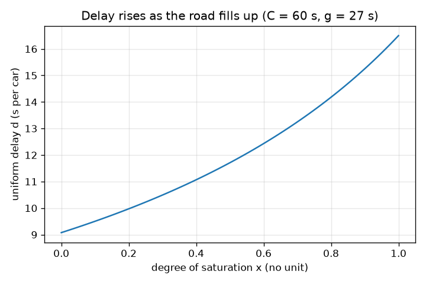
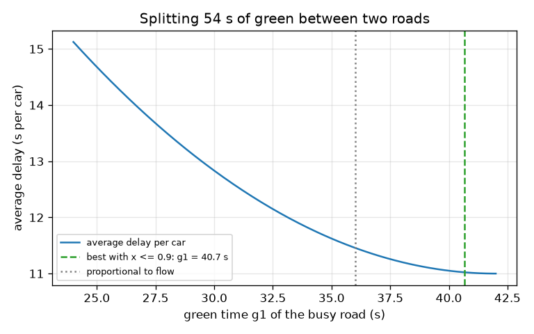

# Session 2: Delay from cycle time, green split and flow

*Level 2 (mathematical engineering model) · about 75 minutes · opentrafficsignal*

> This is a simplified educational model. It is not a validated design tool and must not be used for real structures, electrical installations, vehicles, industrial processes or medical decisions.

**Prerequisites**

- Session 1: queue, capacity and the peak queue q r.
- Squares and fractions in a formula; the triangle area (half base times height).

**Learning objectives.** After this session you can:

- Compute the flow ratio, green ratio and degree of saturation of an approach.
- Derive and use the uniform delay d = C (1 - g/C)^2 / (2 (1 - q/s)) for the deterministic queue.
- Read a cumulative arrival and departure diagram: the area between the curves is waiting time.
- Split a cycle between two roads to minimise total delay under a degree-of-saturation limit, and compute Webster's cycle.

## A. Real-world problem
A main road carries 0.20 cars per second and a side road 0.10. The cycle is 60 seconds. If both roads get the same green, the main road is nearly full while the side road is half empty. How many seconds of green should each get, and how long will drivers wait on average? Too little for the busy road and its queue never ends; too little for the quiet road and a few drivers wait a very long time. We turn the queue of Session 1 into a formula for the average delay per car. This is a simplified educational model; real junction timing follows national guidance and measured data.

## B. Concept and theory
Use effective green g (the time cars really leave) and effective red r = C - g. The flow ratio is y = q / s, the green ratio is lam = g / C, the capacity is s lam and the degree of saturation is x = q / (s lam). Plot cumulative arrivals (a straight line of slope q) and cumulative departures (flat on red, slope s while a queue exists on green). The vertical gap is the queue; the horizontal gap is a car's wait; the area between the curves is the total waiting time per cycle. It is a triangle with height q r (the peak queue) and base r s / (s - q) (the time until the queue is gone), so its area is q r^2 s / (2 (s - q)). Dividing by the q C cars that pass in one cycle gives Webster's uniform delay d = C (1 - lam)^2 / (2 (1 - q/s)) seconds per car. It assumes even arrivals and x <= 1; random surges add a further term in practice. For two roads sharing a cycle, the effective greens add up to C - L, where L is the lost time per cycle (6 s here, from two 3 s ambers). The quantity to minimise is the total delay rate q1 d1 + q2 d2 (car-seconds of waiting per second), or the average delay (q1 d1 + q2 d2) / (q1 + q2). Webster's rule of thumb for the cycle is C = (1.5 L + 5) / (1 - Y), where Y is the sum of the critical flow ratios of the phases, and the green is shared in proportion to the flow ratios.

| Symbol | Meaning | Unit |
|---|---|---|
| C | cycle time | s |
| g | effective green of one approach | s |
| q | arrival rate | cars per second |
| s | saturation flow (typical value 0.5 per lane) | cars per second |
| y | flow ratio q / s | no unit |
| lam | green ratio g / C | no unit |
| x | degree of saturation q C / (g s) | no unit |
| d | uniform delay per car | s |
| L | lost time per cycle (6 s) | s |
| Y | sum of critical flow ratios | no unit |

**Assumptions**

- Even (deterministic) arrivals and constant saturation flow while a queue exists.
- The queue clears every cycle: x <= 1 (above that the formula does not apply and the delay has no limit).
- Amber is lost time: effective green equals displayed green; L = 6 s for two phases.
- One lane per approach, two phases, no turning cars; flows constant over the hour.

$$ y=\frac{q}{s},\qquad \lambda=\frac{g}{C},\qquad x=\frac{q}{s\lambda}=\frac{qC}{sg} $$

$$ \text{area per cycle}=\frac12\,(q r)\left(\frac{r s}{s-q}\right),\qquad d=\frac{\text{area}}{qC} $$

$$ d=\frac{C\,(1-g/C)^2}{2\,(1-q/s)}\quad(x\le 1) $$

$$ \min_{g_1}\ \frac{q_1 d_1(g_1)+q_2 d_2(C-L-g_1)}{q_1+q_2}\quad\text{subject to } x_1\le x_{\max},\ x_2\le x_{\max} $$

$$ C_{\text{Webster}}=\frac{1.5L+5}{1-Y},\qquad g_i=(C-L)\,\frac{y_i}{Y} $$

## C. Visual explanation
The first figure shows the delay of one approach (C = 60 s, g = 27 s) against its degree of saturation: it rises slowly and then steeply, reaching 16.5 s at x = 1. The second figure shows the average delay of the two-road junction against the green given to the busy road. The curve falls as the busy road gets more green; its lowest point, 11.0 s, is at 42 s, exactly where the quiet road reaches x = 1, so any design should keep away from that edge. The dashed green line marks the best split under the limit x <= 0.9 (40.7 s, 11.02 s), and the dotted line is the proportional split (36 s, 11.46 s). The equal split of 27 s each gives 13.86 s.

*Uniform delay against degree of saturation for C = 60 s, g = 27 s: slow rise, then steep.*

*Average delay against the green given to the busy road, with the x <= 0.9 optimum and the proportional split marked.*

## D. Interactive simulation
Run the lesson (`python start.py 2`), then open the live app: [Session 2: delay and the green split](https://krunalpanchal1995.github.io/opentrafficsignal/session-02/) (or `app.html` in this folder). Use the cumulative view to see the triangle between arrivals and departures of road 1, then open the delay view and move the green split slider across the curve. Try the preset that starves the quiet road.

**Challenge.** Get the average delay per car to 11.5 s or less while both roads keep a degree of saturation of 0.9 or less.

## E. Worked example and experiment
**Problem.** With C = 60 s, effective green 27 s for each road (54 s in total, L = 6 s), s = 0.5 cars per second, find x and d for the main road (q = 0.20) and the side road (q = 0.10), and the average delay per car of the junction.

1. Green ratio lam = 27 / 60 = 0.45 for both roads, so (1 - lam)^2 = 0.55^2 = 0.3025.
2. Main road: x = 0.20 x 60 / (27 x 0.5) = 12 / 13.5 = 0.889 (below 1, the queue clears).
3. Main road delay: d = 60 x 0.3025 / (2 (1 - 0.20/0.5)) = 18.15 / (2 x 0.6) = 15.125 s.
4. Side road: x = 0.10 x 60 / 13.5 = 0.444 and d = 18.15 / (2 (1 - 0.2)) = 18.15 / 1.6 = 11.344 s.
5. Average delay per car = (0.20 x 15.125 + 0.10 x 11.344) / 0.30 = (3.025 + 1.134) / 0.30 = 13.86 s.

**Answer.** Main road x = 0.889, d = 15.125 s; side road x = 0.444, d = 11.344 s; average delay 13.86 s per car. Giving the main road 40.7 s and the side road 13.3 s lowers it to 11.02 s with both x at most 0.9.

**Experiment.** At a junction with a measured plan (your school gate, say), time how long 20 cars wait from joining the queue to crossing the stop line, during one hour of constant traffic, and count the cars per minute. Compare the average with the formula. Real delays are usually larger than the uniform term: cars arrive in random bunches (the random term), drivers need a second or two to start, and the saturation flow is not constant. The formula describes the neat deterministic case only; Session 3 measures the gap.

## F. Assessment and design challenge
**Question type A: Conceptual.** Why does the uniform delay contain the square of the red fraction, (1 - g/C)^2, and not just the red fraction? What does a longer red do to the queue and to each car's wait?

Hint

Think of the triangle: both its height and its base depend on r.

Step-by-step solution

The peak queue is q r (the height of the triangle) and the time it takes to clear is proportional to r as well (the base). The total waiting time is the area, which is proportional to r times r. Per car, the delay therefore grows with r squared divided by the cycle length. Doubling the red roughly quadruples the delay per car.

**Question type B: Numerical.** A road has C = 90 s, effective green 40 s and q = 0.15 cars per second (s = 0.5). Find the degree of saturation and the uniform delay. Check the units and decide whether the formula applies.

Hint

x = q C / (g s); d = C (1 - g/C)^2 / (2 (1 - q/s)).

Step-by-step solution

x = 0.15 x 90 / (40 x 0.5) = 13.5 / 20 = 0.675 (no unit), below 1, so the formula applies. d = 90 x (1 - 40/90)^2 / (2 (1 - 0.15/0.5)) = 90 x 0.3086 / 1.4 = 19.84 s per car. Units: seconds x (no unit) / (no unit) = seconds. Sanity check: the red lasts 50 s, a car arriving at a random moment of the red waits 25 s on average, and the cars arriving during green wait less, so about 20 s is reasonable.

**Question type C: Graph and simulation interpretation.** In the delay-against-split graph (C = 60 s, q1 = 0.20, q2 = 0.10), the curve is not defined for splits below about 44 percent or above about 78 percent. Why, and where is the minimum?

Hint

Find the shares at which x1 = 1 and x2 = 1; total effective green is 54 s.

Step-by-step solution

For road 1, x1 = 1 needs g1 = q1 C / s = 24 s, which is 24 / 54 = 44.4 percent of the green; below it the main road is oversaturated and its delay has no limit. For road 2, x2 = 1 needs g2 = 12 s, so g1 = 42 s, 77.8 percent; above it the side road is oversaturated. Between the two the delay is finite. The minimum, 11.0 s, sits at the right-hand edge (42 s) where the quiet road is exactly full, which is why a design limit such as x <= 0.9 is needed.

**Question type D: Design and optimisation challenge.** Design: with C = 60 s, q1 = 0.20 and q2 = 0.10 cars per second, choose the effective greens (total 54 s) that minimise the average delay with both degrees of saturation at most 0.9. Compare with the equal split and the proportional split. What would you check before using it?

Hint

The delay falls as g1 grows until x2 hits its limit: g2 >= q2 C / (0.9 s).

Step-by-step solution

g2 >= 0.10 x 60 / (0.9 x 0.5) = 13.3 s, so g1 = 54 - 13.3 = 40.7 s. Then x1 = 0.59, x2 = 0.90 and the average delay is 11.02 s. The equal split (27 / 27) gives 13.86 s and the proportional split (36 / 18) gives 11.46 s, so the designed split saves 2.8 s per car against equal. The unconstrained optimum (42 / 12, 11.00 s) saves only 0.02 s more but leaves the side road at x = 1, where random bunches make queues explode. Before using it: random arrivals (Session 3), pedestrian crossing time, the effect on the side road's queue length, and a minimum green for safety.

Score yourself with [RUBRIC.md](../../RUBRIC.md). Print the [activity sheet](activity_sheet.md) to work on paper.

## Common misconceptions
| Common misconception | What is actually true |
|---|---|
| Delay is proportional to the length of the red. | It grows with the square of the red fraction: the peak queue and the clearing time both grow with r. |
| The best split gives each road the same degree of saturation. | Equal x is Webster's rule of thumb and a good, safe split, but the uniform delay formula alone is lowest when the quiet road is pushed to x = 1; designers keep x below about 0.9. |
| A shorter cycle always means less delay. | In the uniform formula the delay does grow with C, but a short cycle wastes a larger share on lost time, capacity falls and the queue stops clearing; Session 3 shows the valley. |
| The formula works for any flow. | It needs x <= 1. At x > 1 the queue never clears and the delay keeps growing with time. |

## Glossary
- **effective green**: the time during which cars really leave the queue; here equal to the displayed green
- **lost time**: seconds per cycle in which nobody leaves, such as amber
- **flow ratio**: y = q / s, the share of the time an approach needs to discharge its cars
- **degree of saturation**: x = q C / (g s); above 1 the approach is oversaturated
- **uniform delay**: average delay per car of the deterministic queue
- **critical flow ratio**: the largest flow ratio among the approaches of one phase

## Finish
1. Do the three coding tasks in [exercises.md](exercises.md).
2. Run `python start.py 2` again after your changes. It ends with the checkpoint; when it prints `PASS`, you are done. (Checkpoint only: `python start.py check 2`.)

Next: [Session 3](../session-03/README.md)
