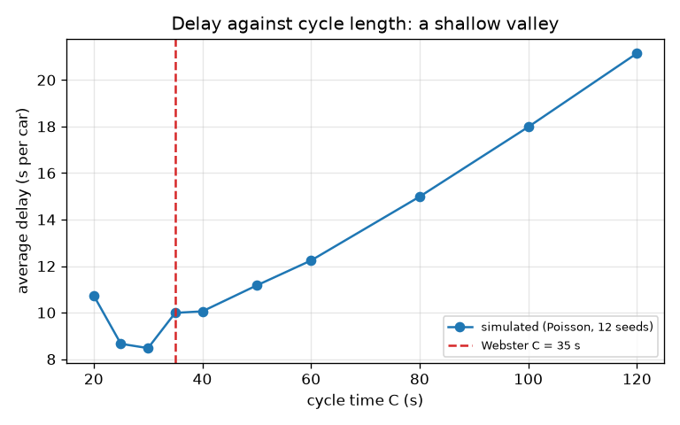
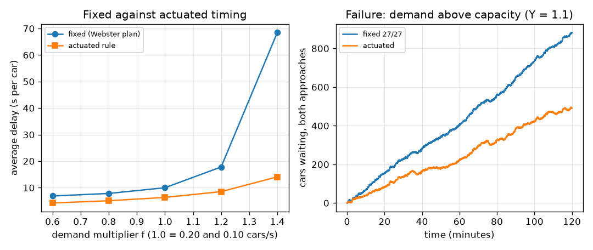

# Session 3: A junction simulator, checked against the formula

*Level 3 (simulation and validation) · about 90 minutes · opentrafficsignal*

> This is a simplified educational model. It is not a validated design tool and must not be used for real structures, electrical installations, vehicles, industrial processes or medical decisions.

**Prerequisites**

- Session 1: queue and capacity.
- Session 2: uniform delay, degree of saturation and Webster's cycle.
- Python functions and lists (Section B explains the rest).

**Learning objectives.** After this session you can:

- Simulate a junction with seeded random (Poisson) arrivals, a fixed plan and a simple actuated rule.
- Validate the simulation against the uniform-delay formula (even arrivals) and against conservation of cars.
- Measure how average delay depends on cycle length and on arrival rates, and compare with Webster's optimum cycle.
- Produce and explain a failure case: oversaturation, where queues grow without bound.

## A. Real-world problem
Real cars do not arrive at neat intervals; they come in random bunches. Does the tidy formula of Session 2 still describe them? Does a signal that reacts to the queues beat a fixed timetable? And what happens when more cars arrive than the junction can ever serve? We answer with a simulator whose every car has an arrival time and a leaving time, so we can count the waiting exactly. This is a simplified educational model, not a traffic engineering tool; real signal timing needs measured data, safety checks and professional review.

## B. Concept and theory
Arrivals are a Poisson process with average rate q: the gaps between cars are exponentially distributed, and a seeded random generator makes every run repeatable. For validation we also use perfectly even arrivals, which match the assumptions of the formula. Time advances in steps of 0.5 s. In each step new cars join their queue, the controller says which phase is green or amber, and cars of a green approach leave at the saturation flow s (a credit grows by s dt per step and a car leaves each time it reaches 1; the first car of a green leaves at once). Delay of a car = time it crosses the stop line minus its arrival time; cars still waiting at the end count their delay so far. The fixed controller follows a timetable. The actuated controller keeps green while the phase still has a queue (up to a maximum of 45 s) and hands over when that queue is empty and the other phase waits, but not before a minimum of 8 s. Checks: (1) conservation, arrived = departed + still waiting; (2) with even arrivals the simulated delay should be close to the uniform delay; (3) the sum of all car delays equals the area under the queue curve (Little's law). Webster's cycle C = (1.5 L + 5) / (1 - Y) is a classic rule of thumb for the cycle that minimises delay including random effects; the delay is nearly flat around it.

| Symbol | Meaning | Unit |
|---|---|---|
| q | arrival rate | cars per second |
| s | saturation flow (typical value 0.5 per lane) | cars per second |
| dt | time step | s |
| C, g | cycle time and green time | s |
| d | average delay per car | s |
| Q_max | largest queue on any approach | cars |
| Y | sum of the critical flow ratios of the two phases | no unit |
| L | lost time per cycle (6 s) | s |

**Assumptions**

- Poisson arrivals with constant rates; one lane per approach unless s is given per approach; no turning cars, pedestrians, buses or incidents.
- Cars cross the stop line at exactly the saturation flow with no start-up loss; amber is the only lost time.
- A one-hour run starting from empty roads, so the first minutes are a warm-up that slightly lowers the average.
- The actuated rule is deliberately simple: it knows the exact queue length, which a real detector only estimates.

$$ P(\text{gap} > t)=e^{-q t}\quad\text{(Poisson arrivals: exponential gaps)} $$

$$ N_{\text{arrived}}=N_{\text{departed}}+N_{\text{waiting}}\quad\text{(conservation of cars)} $$

$$ \sum_i d_i \;\approx\; \int Q(t)\,dt\quad\text{(total delay = area under the queue curve)} $$

$$ d_{\text{uniform}}=\frac{C(1-g/C)^2}{2(1-q/s)},\qquad C_{\text{Webster}}=\frac{1.5L+5}{1-Y} $$

$$ \text{queue growth rate}\approx q-\frac{s\,g}{C}\quad(q>\text{capacity}) $$

## C. Visual explanation
The first figure plots the average delay of fixed timing against the cycle time for 10 values from 20 s to 120 s (12 seeds each). It is a shallow valley: 10.7 s at 20 s, a minimum of 8.5 s at 30 s, about 10 s at the Webster value of 35 s, then a steady climb to 21.1 s at 120 s. The second figure has two panels. Left: average delay against a demand multiplier f for the Webster fixed plan and the actuated rule; the fixed plan collapses beyond the demand it was made for (68.5 s at f = 1.4) while the actuated rule only drifts up (14.1 s). Right: the failure case, cars waiting against time when the demand needs more than all the green there is (flow ratio Y = 1.1): the queue grows in a straight line for both controllers, however they are timed.

*Average delay against cycle length: a shallow valley with its minimum near 30 s; Webster says 35 s.*

*Left: fixed Webster plan against the actuated rule as demand grows. Right: oversaturation (Y = 1.1): queues grow in a straight line.*

## D. Interactive simulation
Run the lesson (`python start.py 3`), then open the live app: [Session 3: seeded junction simulation](https://krunalpanchal1995.github.io/opentrafficsignal/session-03/) (or `app.html` in this folder). Choose a cycle time and a demand multiplier, step the seed to see how much one hour of random cars differs from another, then compare the fixed and the actuated curves in both views. Push the demand to the maximum to cause the failure.

**Challenge.** Set the demand to 1.2 times the base and the cycle time to within 3 s of Webster's optimum for that demand.

## E. Worked example and experiment
**Problem.** Two roads with q = (0.20, 0.10) cars per second, s = 0.5, a fixed plan of 27 s + 27 s of green (C = 60 s). Validate the simulator: (1) even arrivals against the formula of Session 2, (2) conservation, (3) Little's law. Then show how random arrivals change the answer.

1. Formula from Session 2: 13.86 s average delay per car (15.125 s for the main road, 11.344 s for the side road).
2. Simulation with even arrivals over 2 hours: 13.44 s, 3.1 percent below the formula (the car-by-car departures differ slightly from a smooth fluid). The largest queue is 7 cars, in line with q r = 0.2 x 33 = 6.6.
3. Conservation: 1440 + 720 cars arrived, 1433 + 720 departed and 7 + 0 are still waiting, so the gap arrived - departed - waiting is 0 for both roads.
4. Little's law: the car delays add up to 29033 car-seconds and the area under the queue curve is 28495, 1.9 percent apart (the queue is sampled once per step).
5. Poisson arrivals, 12 seeds: 19.50 s average delay and 18.5 cars largest queue, against 13.44 s and 7 cars for even arrivals: the random bunches add about 6 s per car.

**Answer.** The simulator reproduces the formula within 3.1 percent for even arrivals, conserves cars exactly and obeys Little's law within 2 percent. With random arrivals the same plan gives 19.5 s instead of 13.4 s: the formula is the delay of a perfectly regular road and is a lower bound for a random one.

**Experiment.** Record 15 minutes of video of a real junction approach and note each car's arrival and crossing time; compute the average delay and the largest queue and compare with the simulator run at the measured flow. Expect the real delay to be larger than the even-arrival formula and similar to the random simulation, with differences from start-up loss, turning cars, pedestrians, gap acceptance and flow that changes during the 15 minutes. A model with constant flow, no start-up loss and exact detectors flatters the actuated rule.

## Real-world application and mini-project: Time a junction from its traffic counts
The city gives you 15-minute counts for a four-way junction, every approach with two lanes (saturation flow 1.0 car per second per approach, typical value) and 3 seconds of amber: north 360 cars, east 270, south 315, west 225. North and south share phase 0, east and west share phase 1. Turn the counts into flows, find the critical flow ratio of each phase, time the junction with `webster_plan`, and compare it with a fixed plan of 27 s and 27 s of green and with the actuated rule over 12 seeds.

**Deliverable:** A script that prints the flows (cars per second), the critical flow ratios and Y, the Webster cycle and the two greens, then a table of average delay and largest queue over 12 seeds for the Webster plan, the 27 s / 27 s plan, a 39 s / 39 s plan and the actuated rule. Save a bar chart of average delay.

**Success looks like:** Y = 0.70, Webster cycle 46.7 s, greens 23.2 s (north-south) and 17.4 s (east-west). With 12 seeds the Webster plan gives about 11.5 s average delay against about 14.4 s for 27 s / 27 s (at least 15 percent lower), and the actuated rule gives about 7.3 s. State one reason why a real junction would not simply copy these numbers.

## F. Assessment and design challenge
**Question type A: Conceptual.** Even and Poisson arrivals have the same average flow, yet Poisson arrivals give more delay and longer queues. Why? Could random arrivals ever give less delay than even ones on average?

Hint

What does a bunch of cars do when it arrives just after the light turns red?

Step-by-step solution

A random stream sometimes delivers many cars in a short time and sometimes none. Bunches that arrive during red make long queues, and the spare capacity during the quiet stretches cannot be saved for later: green time with an empty queue is wasted. Because delay grows faster than linearly with the queue, the bunches cost more than the gaps save. On average randomness does not reduce delay; the effect is largest near saturation. (In a lucky single hour one random run can beat the formula, but not on average.)

**Question type B: Numerical.** A two-phase junction has q = (0.25, 0.15) cars per second, s = 0.5 and L = 6 s. Find Y, Webster's cycle and the two greens. One simulation run reports 720 cars arrived on road 2 and 719 departed. How many are still waiting?

Hint

Y = q1/s + q2/s; C = (1.5 L + 5) / (1 - Y); g_i = (C - L) y_i / Y; conservation.

Step-by-step solution

y1 = 0.25 / 0.5 = 0.5, y2 = 0.15 / 0.5 = 0.3, Y = 0.8. C = (1.5 x 6 + 5) / (1 - 0.8) = 14 / 0.2 = 70 s. Spare green C - L = 64 s, shared g1 = 64 x 0.5 / 0.8 = 40 s and g2 = 64 x 0.3 / 0.8 = 24 s. Conservation: waiting = arrived - departed = 720 - 719 = 1 car. Units: Y has no unit; C and g are in seconds; cars are counted in cars.

**Question type C: Graph and simulation interpretation.** In the delay-against-cycle graph (q = 0.20 and 0.10, Webster C = 35 s), describe the curve on the left and on the right of its minimum and say what the simulation finds as the best cycle.

Hint

Use the numbers: 20 s, 30 s, 35 s and 120 s.

Step-by-step solution

Left of the minimum the delay rises again (10.7 s at 20 s) because a short cycle wastes a large share of its time on amber, capacity falls and queues no longer clear. Right of it the delay climbs steadily (21.1 s at 120 s) because the red gets long and the delay grows with C. The simulated best cycle is 30 s (8.5 s); at Webster's 35 s the delay is 10.0 s. The valley is shallow and Webster's value is a good rule of thumb but not the exact minimum of this simplified simulator, which has no start-up loss and so favours shorter cycles.

**Question type D: Design and optimisation challenge.** Design: the junction of the worked example (q = 0.20 and 0.10) was timed with Webster's cycle for its own demand (C = 35 s). In the evening the demand rises to 1.4 times (q = 0.28 and 0.14). The simulation gives 68.5 s average delay with the old plan. Re-time it with Webster's formula, give the new cycle and greens, and say when you would prefer an actuated rule.

Hint

Y becomes 1.4 x 0.6 = 0.84; then C = 14 / (1 - Y) and g_i = (C - 6) y_i / Y.

Step-by-step solution

Y = 0.84, so C = 14 / 0.16 = 87.5 s; spare green 81.5 s is shared 2 : 1, giving g1 = 54.3 s and g2 = 27.2 s. The degrees of saturation are about 0.90 for both roads. Simulation (12 seeds): 29.2 s average delay instead of 68.5 s, and the actuated rule gives 14.0 s. An actuated rule is preferable when demand varies in time or is poorly known, because it needs no forecast; a fixed plan is preferable where detectors are unreliable, where signals must be coordinated with neighbours, or where predictability matters. Trade-offs: the long cycle needed at high demand makes the side road wait long, and the actuated rule can give erratic waits.

Score yourself with [RUBRIC.md](../../RUBRIC.md). Print the [activity sheet](activity_sheet.md) to work on paper.

## Common misconceptions
| Common misconception | What is actually true |
|---|---|
| A simulation is right because it ran without errors. | It is trusted only after checks: conservation, agreement with a formula in a case where the formula applies, and sensible sensitivity. |
| One random run is the answer. | One hour of seeded arrivals is one sample; delays across seeds ranged from 16 s to 31 s in the first test. Average over seeds before comparing plans. |
| Webster's cycle is the exact best for any junction. | It is a rule of thumb from a particular set of assumptions; the minimum is shallow and the best simulated cycle here is 30 s against Webster's 35 s. |
| An actuated signal can serve any demand. | No controller can serve a demand with Y > 1: green time is limited, and the queues grow whatever the rule. |

## Glossary
- **Poisson process**: random arrivals with a constant average rate; the gaps between cars are exponential
- **seed**: the starting number of a random generator; the same seed repeats the same run
- **actuated signal**: a signal that adjusts its green to detected queues
- **conservation**: cars are neither created nor lost: arrived = departed + waiting
- **Little's law**: total waiting time equals the area under the queue-length curve
- **oversaturation**: demand above capacity: the queue grows without bound

## Finish
1. Do the three coding tasks in [exercises.md](exercises.md).
2. Run `python start.py 3` again after your changes. It ends with the checkpoint; when it prints `PASS`, you are done. (Checkpoint only: `python start.py check 3`.)

Next: the [roadmap](../../promo/roadmap.md). Session 4 is yours to build.
